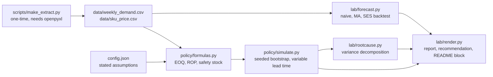

# SPEC: inventory-policy-lab

## Problem

A supply chain analyst needs to turn real weekly demand into an inventory policy and then check that the policy delivers the service level it promises. For 40 SKUs the lab derives a forecast, the economic order quantity (EOQ), reorder point, safety stock and target service level, then replays the policy against bootstrapped demand with variable lead time and reports achieved service level and fill rate against target.

Edge over typical write-ups: every formula is tested against a hand-worked textbook case, a planted wrong formula turns the suite RED, and every number in the README, report and recommendation is regenerated by one command.

## Binary exits

| Id | Exit | Command |
|----|------|---------|
| E1 | Whole test suite passes | `make test` |
| E2 | Hand-worked EOQ and safety-stock cases pass | `python3 -m pytest -q tests/test_formulas.py` |
| E3 | Simulation is seed-stable | `python3 -m pytest -q tests/test_simulation.py` |
| E4 | Planted formula fault is caught | `make selftest` (exits 0 only if the fault is caught) |
| E5 | Regeneration is idempotent | `make regen` twice, `git diff --stat` empty after the second |
| E6 | README Results block equals generated output | `python3 -m pytest -q tests/test_readme_drift.py` |
| E7 | No banned word, no em dash | `grep -rniE "<banned list>" --exclude-dir=.git .` prints nothing |
| E8 | No PROVEN row without an existing test id | `python3 -m pytest -q tests/test_trace.py` |
| E9 | Everything committed, owner identity only | `git status --short` empty |

## Requirement to test trace

Counts are from 10 live US-remote Supply Chain / Inventory / Demand Planning Analyst postings sampled 2026-11-17 (no company names). Rows are ordered by count, highest first.

| Requirement | Seen in | File | Test id | Status |
|-------------|---------|------|---------|--------|
| Inventory / safety stock | 10/10 | policy/formulas.py | tests/test_formulas.py::test_eoq_hand_worked_textbook, tests/test_formulas.py::test_safety_stock_worked_example | PROVEN |
| Spreadsheets | 10/10 | none | none | GAP |
| Forecasting / demand planning: moving average and simple exponential smoothing, rolling-origin backtest, MAE and WAPE per SKU and overall, naive baseline | 9/10 | lab/forecast.py | tests/test_forecast.py::test_ses_hand_worked, tests/test_forecast.py::test_moving_average_hand_worked, tests/test_forecast.py::test_rolling_origin_has_no_lookahead, tests/test_forecast.py::test_wape_hand_worked | PROVEN |
| Stakeholders / cross-functional (docs/recommendation.md is a written output, no test shows it serves a stakeholder) | 9/10 | none | none | GAP |
| Communication: written output, numbers tested; no live presentation | 9/10 | docs/recommendation.md | tests/test_report.py::test_recommendation_matches_regenerated_numbers | PARTIAL |
| Logistics / procurement / supplier management (no supplier data in the source) | 7/10 | none | none | GAP |
| ERP | 6/10 | none | none | GAP |
| Dashboards / reporting: static report, inline SVG, no external assets | 6/10 | lab/render.py | tests/test_report.py::test_report_is_static_and_self_contained | PROVEN |
| Recommendations / insights: numbers regenerated | 5/10 | docs/recommendation.md | tests/test_report.py::test_recommendation_matches_regenerated_numbers | PROVEN |
| KPIs / metrics: service level, fill rate, stockout weeks, average inventory, turns | 4/10 | policy/simulate.py | tests/test_simulation.py::test_kpis_hand_worked | PROVEN |
| Root cause analysis: demand variability vs lead-time variability decomposition for SKUs that miss target | 4/10 | lab/rootcause.py | tests/test_rootcause.py::test_variance_decomposition_hand_worked | PROVEN |
| A BI tool | 4/10 | none | none | GAP |
| Financial modelling (only holding and ordering cost assumptions are modelled) | 2/10 | none | none | GAP |
| Data quality: extract checks | 1/10 | tests/test_data_quality.py | tests/test_data_quality.py::test_weekly_demand_checks | PROVEN |

Gaps are never claimed in the README or the report.

## Pipeline

## Standards (fetched 2026-11-17)

| Name | URL | Line relied on | Fetched |
|------|-----|----------------|---------|
| EOQ, Business LibreTexts, Introduction to Operations Management, section 9.4 | https://biz.libretexts.org/Courses/Northeast_Wisconsin_Technical_College/Introduction_to_Operations_Management_(NWTC)/09:_Inventory_Management/9.04:_Inventory_Models_for_Certain_Demand_-_Economic_Order_Quantity_(EOQ) | "EOQ=Q*=the square root of 2DS over H" with D demand per year, S order cost per order, H carrying cost per item per year. Worked example D=1500, S=625, H=130 gives Q*=120.1 | 2026-11-17 |
| Safety stock with demand and lead-time variability, King, "Crack the Code", APICS Magazine, hosted on the MIT 2.810 course site | https://web.mit.edu/2.810/www/files/readings/King_SafetyStock.pdf | "In cases where demand and lead time variability are independent ... and both are normally distributed, the combined safety stock equation becomes" Z times the square root of ((lead time in demand periods x sigma_D squared) + (sigma_LT x D_avg) squared); "the safety stock is Z-score times the square root of the sum of the squares of the individual variabilities". Worked example: Z=1.65, 8/7 weeks, sigma_D=10, sigma_LT=0.07 weeks, D_avg=50 gives 19 rolls (18 with demand variability only) | 2026-11-17 |
| Reorder point and safety stock definitions, University of Iowa, Dept of Mechanical and Industrial Engineering, Reorder Point slides | https://user.engineering.uiowa.edu/~dbricker/Lecture_Slides/Reorder_Point.pdf | "The re-order point is the sum of the expected lead-time demand and the safety stock." "The safety stock is the product of the safety factor and the standard deviation of lead-time demand." | 2026-11-17 |
| Forecast error measures and rolling origin, Hyndman and Athanasopoulos, Forecasting: Principles and Practice (3rd ed), section 5.8 | https://otexts.com/fpp3/accuracy.html | "Mean absolute error: MAE = mean(|e_t|)"; "Measures based on percentage errors have the disadvantage of being infinite or undefined if y_t = 0"; "This procedure is sometimes known as evaluation on a rolling forecasting origin" | 2026-11-17 |

Where the lab differs from a source:

- The percentage-error line above is why the lab reports WAPE (sum of absolute errors over sum of actuals) instead of MAPE. WAPE is not defined on that page; it is this lab's stated substitute because weekly demand contains zeros.
- The formula follows the King source: lead time and sigma_L are in demand periods (weeks) and the two variability sources are treated as independent. The King worked example is one of the hand-worked tests.
- The simple exponential smoothing and moving-average definitions are the textbook recursions; the tests work them by hand and no standard is cited for them.

## Decisions

- Time unit is the ISO week. The first and last ISO weeks of the dataset are partial (data starts Wednesday 2010-12-01 and ends Friday 2011-12-09) and are dropped.
- Cancellations (invoice numbers starting with C) are netted against sales in the week they occur; weekly demand is floored at zero. Rows with unit price at or below zero (adjustments) and non-product codes (a product code is five digits plus up to two letters) are excluded.
- The 40 SKUs are those with the most weeks of non-zero demand, ties broken by total units then code.
- `data/sku_price.csv` (median unit price per SKU) is added so holding cost scales with item value. Price stands in for unit cost.
- Lead time, ordering cost per order and annual holding rate are stated assumptions in `config.json`; the source has no such data. Lead time is a discrete distribution (1, 2 or 3 weeks with probabilities 0.125, 0.75, 0.125, so mean 2 and standard deviation 0.5 weeks); the formulas use its mean and standard deviation.
- Policy demand rate and sigma_d are the SKU's mean and sample standard deviation of weekly demand. The forecast backtest is reported next to the policy and supplies the next-week outlook; it does not feed the formulas.
- Inventory is checked once a week (the data grain), so the formulas use a protection interval of lead time plus the review period (1 week, `review_period_weeks` in `config.json`). Without it the continuous-review formula under-protects when stock is only checked weekly. L in the formulas and the reorder point means this protection interval.
- Simulation: weekly steps, lost sales on a shortage, orders placed at end of week when inventory position is at or below the reorder point, order arrives at end of week t+L. Cycle service level is the share of orders with no shortage inside their lead-time window. Fill rate is units served over units demanded. Demand is an i.i.d. bootstrap of the SKU's own weekly history.
- A SKU meets target when achieved cycle service level is at least target minus the tolerance in `config.json`.
- The planted fault drops the lead-time scaling of the demand term: z * sqrt(sigma_d^2 + d^2 * sigma_L^2) instead of z * sqrt(L * sigma_d^2 + d^2 * sigma_L^2).
- Service level must lie strictly between 0 and 1 (anything else raises ValueError). z is not clamped at either end. Below 50% z is negative, safety stock is then negative, and the reorder point keeps that negative buffer.
- A simulation run that completes no order cycle raises ValueError instead of reporting a service level.
- The order quantity is at least 1 unit, so a near-zero-demand SKU never gets an order size of 0.
- `make selftest` exits 0 only when the correct formula passes the check and the planted fault fails it; either one wrong exits 1.
- A SKU's description is the most common description among its sale rows.
- WAPE and MAE are undefined without demand: `wape` raises ValueError when the test-window actuals sum to zero and `mae` raises on an empty test window. The pipeline fails and names the SKU rather than skipping it, so every reported number always covers all SKUs.
- The simulation raises ValueError for a window of zero weeks. Fill rate and turns need no further guard: a completed cycle needs demand to have drawn stock down to the reorder point, and an arrival after warm-up leaves stock above zero at that week's end.
