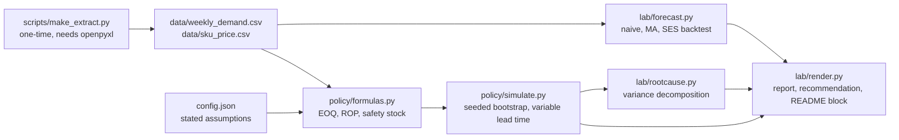

# SPEC: inventory-policy-lab

## Problem

A supply chain analyst needs to turn real weekly demand into an inventory policy and then check that the policy delivers the service level it promises. For 40 SKUs the lab derives a forecast, the economic order quantity (EOQ), reorder point, safety stock and target service level, then replays the policy against bootstrapped demand with variable lead time and reports achieved service level and fill rate against target.

Edge over typical write-ups: every formula is tested against a hand-worked textbook case, a planted wrong formula turns the suite RED, and every number in the README, report and recommendation is regenerated by one command.

## Binary exits

| Id | Exit | Command |
|----|------|---------|
| E1 | Whole test suite passes | `make test` |
| E2 | Hand-worked EOQ and safety-stock cases pass | `python3 -m pytest -q tests/test_formulas.py` |
| E3 | Simulation is seed-stable | `python3 -m pytest -q tests/test_simulation.py` |
| E4 | Planted formula fault is caught | `make selftest` (exits 0 only if the fault is caught) |
| E5 | Regeneration is idempotent | `make regen` twice, `git diff --stat` empty after the second |
| E6 | README Results block equals generated output | `python3 -m pytest -q tests/test_readme_drift.py` |
| E7 | No banned word, no em dash | `grep -rniE "<banned list>" --exclude-dir=.git .` prints nothing |
| E8 | No PROVEN row without an existing test id | `python3 -m pytest -q tests/test_trace.py` |
| E9 | Everything committed, owner identity only | `git status --short` empty |

## Requirement to test trace

Counts are from 10 live US-remote Supply Chain / Inventory / Demand Planning Analyst postings sampled 2026-11-17 (no company names). Rows are ordered by count, highest first.

| Requirement | Seen in | File | Test id | Status |
|-------------|---------|------|---------|--------|
| Inventory / safety stock | 10/10 | policy/formulas.py | tests/test_formulas.py::test_eoq_hand_worked_textbook, tests/test_formulas.py::test_safety_stock_worked_example | PROVEN |
| Spreadsheets | 10/10 | none | none | GAP |
| Forecasting / demand planning: moving average and simple exponential smoothing, rolling-origin backtest, MAE and WAPE per SKU and overall, naive baseline | 9/10 | lab/forecast.py | tests/test_forecast.py::test_ses_hand_worked, tests/test_forecast.py::test_moving_average_hand_worked, tests/test_forecast.py::test_rolling_origin_has_no_lookahead, tests/test_forecast.py::test_wape_hand_worked, tests/test_forecast.py::test_mae_hand_worked, tests/test_hand_worked_pipeline.py::test_per_sku_mae_and_wape_hand_worked, tests/test_hand_worked_pipeline.py::test_overall_wape_hand_worked | PROVEN |
| Stakeholders / cross-functional (docs/recommendation.md is a written output, no test shows it serves a stakeholder) | 9/10 | none | none | GAP |
| Communication: written output, numbers tested; no live presentation | 9/10 | docs/recommendation.md | tests/test_report.py::test_recommendation_matches_regenerated_numbers | PARTIAL |
| Logistics / procurement / supplier management (no supplier data in the source) | 7/10 | none | none | GAP |
| ERP | 6/10 | none | none | GAP |
| Dashboards / reporting: static report, inline SVG, no external assets | 6/10 | lab/render.py | tests/test_report.py::test_report_is_static_and_self_contained | PROVEN |
| Recommendations / insights: numbers regenerated | 5/10 | docs/recommendation.md | tests/test_report.py::test_recommendation_matches_regenerated_numbers | PROVEN |
| KPIs / metrics: service level, fill rate, stockout weeks, average inventory, turns | 4/10 | policy/simulate.py | tests/test_simulation.py::test_kpis_hand_worked | PROVEN |
| Root cause analysis: demand variability vs lead-time variability decomposition for SKUs that miss target | 4/10 | lab/rootcause.py | tests/test_rootcause.py::test_variance_decomposition_hand_worked, tests/test_render_misses.py::test_recommendation_with_a_miss_renders_the_table_and_count | PROVEN |
| A BI tool | 4/10 | none | none | GAP |
| Financial modelling (only holding and ordering cost assumptions are modelled) | 2/10 | none | none | GAP |
| Data quality: extract checks | 1/10 | tests/test_data_quality.py | tests/test_data_quality.py::test_weekly_demand_checks, tests/test_extract_checks_fixture.py::test_extract_output_passes_the_data_quality_checks_on_a_small_fixture | PROVEN |

Gaps are never claimed in the README or the report.

## Pipeline



### Config values

`config.json` holds exactly these values; `tests/test_pins_misc.py` compares the two, so a changed value fails until this block is updated with it.

<!-- CONFIG-VALUES:START -->
```json
{
  "seed": 20261117,
  "service_target": 0.95,
  "service_levels": [0.90, 0.95, 0.975, 0.99],
  "lead_time_weeks": {"values": [1, 2, 3], "probs": [0.125, 0.75, 0.125]},
  "review_period_weeks": 1,
  "ordering_cost_per_order": 50.0,
  "holding_rate_per_year": 0.25,
  "ma_window": 4,
  "ses_alpha": 0.3,
  "min_train_weeks": 26,
  "sim_weeks": 5200,
  "sim_warmup_weeks": 52,
  "tolerance": 0.03
}
```
<!-- CONFIG-VALUES:END -->

## Standards (fetched 2026-11-17)

| Name | URL | Line relied on | Fetched |
|------|-----|----------------|---------|
| EOQ, Business LibreTexts, Introduction to Operations Management, section 9.4 | https://biz.libretexts.org/Courses/Northeast_Wisconsin_Technical_College/Introduction_to_Operations_Management_(NWTC)/09:_Inventory_Management/9.04:_Inventory_Models_for_Certain_Demand_-_Economic_Order_Quantity_(EOQ) | "EOQ=Q*=the square root of 2DS over H" with D demand per year, S order cost per order, H carrying cost per item per year. Worked example D=1500, S=625, H=130 gives Q*=120.1 | 2026-11-17 |
| Safety stock with demand and lead-time variability, King, "Crack the Code", APICS Magazine, hosted on the MIT 2.810 course site | https://web.mit.edu/2.810/www/files/readings/King_SafetyStock.pdf | "In cases where demand and lead time variability are independent ... and both are normally distributed, the combined safety stock equation becomes" Z times the square root of ((lead time in demand periods x sigma_D squared) + (sigma_LT x D_avg) squared); "the safety stock is Z-score times the square root of the sum of the squares of the individual variabilities". Worked example: Z=1.65, 8/7 weeks, sigma_D=10, sigma_LT=0.07 weeks, D_avg=50 gives 19 rolls (18 with demand variability only) | 2026-11-17 |
| Reorder point and safety stock definitions, University of Iowa, Dept of Mechanical and Industrial Engineering, Reorder Point slides | https://user.engineering.uiowa.edu/~dbricker/Lecture_Slides/Reorder_Point.pdf | "The re-order point is the sum of the expected lead-time demand and the safety stock." "The safety stock is the product of the safety factor and the standard deviation of lead-time demand." | 2026-11-17 |
| Forecast error measures and rolling origin, Hyndman and Athanasopoulos, Forecasting: Principles and Practice (3rd ed), section 5.8 | https://otexts.com/fpp3/accuracy.html | "Mean absolute error: MAE = mean(|e_t|)"; "Measures based on percentage errors have the disadvantage of being infinite or undefined if y_t = 0"; "This procedure is sometimes known as evaluation on a rolling forecasting origin" | 2026-11-17 |

Where the lab differs from a source:

- The percentage-error line above is why the lab reports WAPE (sum of absolute errors over sum of actuals) instead of MAPE. WAPE is not defined on that page; it is this lab's stated substitute because weekly demand contains zeros.
- The formula follows the King source: lead time and sigma_L are in demand periods (weeks) and the two variability sources are treated as independent. The King worked example is one of the hand-worked tests.
- The simple exponential smoothing and moving-average definitions are the textbook recursions; the tests work them by hand and no standard is cited for them.

## Decisions

- Time unit is the ISO week. The first and last ISO weeks of the dataset are partial (data starts Wednesday 2010-12-01 and ends Friday 2011-12-09) and are dropped.
- Cancellations (invoice numbers starting with C) are netted against sales in the week they occur; weekly demand is floored at zero. Rows with unit price at or below zero (adjustments) and non-product codes (a product code is five digits plus up to two letters) are excluded.
- The 40 SKUs are those with the most weeks of non-zero demand, ties broken by total units then code.
- `data/sku_price.csv` (median unit price per SKU) is added so holding cost scales with item value. Price stands in for unit cost.
- Lead time, ordering cost per order and annual holding rate are stated assumptions in `config.json`; the source has no such data. Lead time is a discrete distribution (1, 2 or 3 weeks with probabilities 0.125, 0.75, 0.125, so mean 2 and standard deviation 0.5 weeks); the formulas use its mean and standard deviation.
- Policy demand rate and sigma_d are the SKU's mean and sample standard deviation of weekly demand. The forecast backtest is reported next to the policy and supplies the next-week outlook; it does not feed the formulas.
- Inventory is checked once a week (the data grain), so the formulas use a protection interval of lead time plus the review period (1 week, `review_period_weeks` in `config.json`). Without it the continuous-review formula under-protects when stock is only checked weekly. L in the formulas and the reorder point means this protection interval.
- Simulation: weekly steps, lost sales on a shortage, orders placed at end of week when inventory position is at or below the reorder point, order arrives at end of week t+L. Cycle service level is the share of orders with no shortage inside their lead-time window. Fill rate is units served over units demanded. Demand is an i.i.d. bootstrap of the SKU's own weekly history.
- A SKU meets target when achieved cycle service level is at least target minus the tolerance in `config.json`.
- The planted fault drops the lead-time scaling of the demand term: z * sqrt(sigma_d^2 + d^2 * sigma_L^2) instead of z * sqrt(L * sigma_d^2 + d^2 * sigma_L^2).
- Service level must lie strictly between 0 and 1 (anything else raises ValueError). z is not clamped at either end. Below 50% z is negative, safety stock is then negative, and the reorder point keeps that negative buffer.
- A simulation run that completes no order cycle raises ValueError instead of reporting a service level.
- The order quantity is at least 1 unit, so a near-zero-demand SKU never gets an order size of 0.
- `make selftest` exits 0 only when the correct formula passes the check and the planted fault fails it; either one wrong exits 1.
- A SKU's description is the most common description among its sale rows.
- WAPE and MAE are undefined without demand: `wape` raises ValueError when the test-window actuals sum to zero and `mae` raises on an empty test window. The pipeline fails and names the SKU rather than skipping it, so every reported number always covers all SKUs.
- The simulation raises ValueError for a window of zero weeks. Fill rate and turns need no further guard: a completed cycle needs demand to have drawn stock down to the reorder point, and an arrival after warm-up leaves stock above zero at that week's end.
- Skewness of a constant series (standard deviation 0) is returned as 0.0. That is a convention, not a mathematical result: the ratio is undefined and 0 is the value of a symmetric series.
- `decompose` raises ValueError when demand variance and lead-time variance are both zero: a zero total has no shares, and a made-up split would name a false main cause. Constant demand alone does not trigger it while lead time varies; the lead-time part then carries a share of 1.
- A negative simulation window is rejected like a zero one: `simulate` raises ValueError when weeks is at or below zero.
- `mae` raises ValueError when actuals and forecasts differ in length, in either direction; an empty actuals list is reported as no test weeks before the length check, so the empty-test-window error names its real cause.
- Skewness treats only an exactly zero standard deviation as constant. `statistics.stdev` is exact for equal floats (0.1, 1/3 and similar give 0.0), so no tolerance is needed and a tiny but real spread keeps its skewness.
- Actuals are demand and cannot be negative: `wape` raises ValueError on any negative actual and keeps its separate error for a zero sum. For valid input a sum is never negative, so a test for a sum at or below zero is the same test as the zero-sum one.
- `decompose` requires lead time, both standard deviations and mean demand to be non-negative, else ValueError. A total of variance parts is then never negative, so the zero check is the only one that can fire.
- The pipeline error for a SKU without test-window demand keeps the original WAPE error as its cause, so the chain shows why.
- `wape` checks in this order: length mismatch, non-finite input, negative actual, zero sum. The negative check comes before the zero-sum check, so `wape([-1, 1], [0, 0])` reports the negative actual rather than a zero sum.
- `wape` raises ValueError when actuals and forecasts differ in length, in either direction, with the same wording as `mae`; the length check runs before the value checks, so a mismatched pair is always reported as a length error.
- `decompose` requires lead time, both standard deviations and mean demand to be finite and at or above 0, else ValueError. The earlier `min(...) < 0` test let a leading NaN hide a later negative and returned NaN.
- `wape` and `mae` raise ValueError on any NaN or infinity in actuals or forecasts: a test showed both returned NaN silently. `mae` checks empty, then length, then finiteness.
- `simulate` rejects bad inputs with ValueError before it starts: an empty history, an order quantity at or below 0 (which would order forever without raising stock), lead values that are not whole weeks of at least 1 (a lead of 0 or less never arrives in order, a fractional one breaks the lead-time window), lead values and probabilities of different length, a negative probability, and probabilities that do not sum to 1 within 1e-9. The checks run after the window check, in that order.
- `moving_average` raises ValueError for a window below 1 (a window of 0 silently averaged the whole history and a negative one dropped weeks). `rolling_origin` raises ValueError for a training minimum below 1 (a forecast needs at least one week of history).
- `make_extract.py` exits non-zero with `no usable rows in the workbook` when no row has both a stock code and a date, and writes nothing, not even the output directory.
- `weekly_demand.csv` must give every SKU the same number of weeks. `pipeline.run` raises ValueError naming the first SKU that differs and both lengths before computing anything, instead of reporting the length of one arbitrary series as `weeks`.
- `make_extract.py` exits non-zero with `the data spans less than one full week` when no ISO week is fully covered, and writes nothing. A ranked SKU with no description in any row gets an empty description and the extract completes.
- `simulate` also rejects a window that is not a plain whole number (a float or a bool), a negative warm-up, and history values that are NaN, infinite or negative (demand cannot be negative), all with ValueError; a bool lead value is rejected like any other non-integer. The window type check runs first, the warm-up check follows the window checks, and the history value check follows the empty-history check.
- `naive_forecast`, `moving_average` and `ses` raise ValueError `series must not be empty` on an empty series; `moving_average` checks its window first.
- `simulate` also requires a reorder point that is finite and not negative (an infinite one never stops ordering), a warm-up that is a whole number (a float, NaN or bool is rejected like the window), and a finite order quantity. Check order: window type, window range, warm-up type, warm-up range, history empty, history values, reorder point, order quantity, then the lead-time checks. A history value is checked at every position, the first included.
- The demand and price files are checked as they are read. Each of these raises one ValueError that names the file and the problem: a missing column, a header-only demand file, a duplicate SKU and week row (the SKU and week are named), a units cell that is not a whole number of at least 0, a SKU in the demand file with no row in the price file, and a median unit price that is not a finite number above 0. Ragged series are still reported after both files have been read.
- `config.json` is validated before any work starts: the service target must be one of `service_levels`, the tolerance finite and not negative, `ses_alpha` above 0 and at most 1, and `sim_weeks` and `sim_warmup_weeks` whole numbers. `make regen` computes and renders every output before it writes the first one, so a failed run leaves the report, recommendation, result tables and README as they were.
- `config.json` must also list both 0.95 and 0.975 in `service_levels`, because the report compares those two rows, and the service target and every service level must be at least 0.5 and below 1. Below 0.5 the safety factor is negative and a skewed SKU can get a negative reorder point, which `simulate` rejects; the config check fails up front instead. With the committed data and a target of 0.5, no SKU reaches `simulate` with a negative reorder point.
- Config completeness and ranges: `validate_config` checks every key the code reads, all thirteen of them (seed, service_target, service_levels, lead_time_weeks with its values and probs, review_period_weeks, ordering_cost_per_order, holding_rate_per_year, ma_window, ses_alpha, min_train_weeks, sim_weeks, sim_warmup_weeks, tolerance). A missing key gives ValueError "config is missing <key>", and a wrong type gives "<key> must be a number" or "<key> must be a whole number"; a bool is neither. Whole numbers: ma_window, min_train_weeks, seed, sim_weeks, sim_warmup_weeks, review_period_weeks. The order is: missing keys in file order, types in file order, target in levels, 0.95 and 0.975 listed, range [0.5, 1), no repeated level, tolerance, ses_alpha, ordering cost, holding rate, review period, lead values, lead length, negative lead probability, lead probability sum; the first failing check is the one reported. `review_period_weeks` must be at least 1 because it is added to the lead time to form the protection interval and 0 would make the weekly check a continuous one the model does not describe. Ordering cost and holding rate must be finite and above 0, lead values whole weeks of at least 1, probabilities not negative and summing to 1 within 1e-9, and a NaN anywhere is rejected. A bad config fails before any data file is read.
- Data files are read as UTF-8 with an optional byte order mark (`utf-8-sig`); `config.json` and the README are read and written as UTF-8. A leading BOM therefore loads like the same file without it. Loader order: the demand file is loaded before the price file, and per demand row the checks are missing cell, whitespace in the stock code, whitespace in the week, week format, duplicate, then units; per price row they are missing code, whitespace, price, then description.
- A stock code or week with leading or trailing whitespace in either file is rejected, not stripped: "<file>: stock code has surrounding whitespace: '<raw>'". A padded code would otherwise be a different SKU that silently matches nothing. A row with a missing cell gives one ValueError naming the file.
- Number cells are strict: a units cell is ASCII digits only (no sign, space, underscore or non-ASCII digit), and a price cell must be ASCII and contain no underscore; the error messages are unchanged.
- Inputs are assumed to be ordinary business magnitudes: weekly units, prices and costs of everyday size. Values near the float limit (1e308, or cells with hundreds of digits) are not supported and have no overflow handling.
- Config bounds are exact, with no tolerance on a comparison: the service target and the levels 0.95 and 0.975 must be listed by equality (0.9500001 is not 0.95), the lower service bound is exactly 0.5 and the upper bound is exclusive, `tolerance` is at least 0 with no upper cap (1.0 and above are accepted), `ses_alpha` is above 0 and at most 1 exactly, `lead_time_weeks.values` and `probs` have equal length in both directions, a probability of exactly 0 is allowed and any negative one is rejected however small, and the probabilities sum to 1 within 1e-9 on either side. Lead `values` are type-checked before `probs`.
- `config.json` and the README are read as UTF-8; a byte that is not valid UTF-8 raises ValueError naming the file ("config.json is not valid UTF-8", "README.md is not valid UTF-8"), and `regen` has written nothing by then. A units cell with a non-ASCII digit-like character (superscript two, a roman numeral, an Arabic-Indic digit) is rejected like any non-digit, and a units cell longer than Python's integer digit limit gets the same units error rather than the interpreter's own message. A description in `sku_price.csv` is kept exactly as written, leading and trailing spaces included.
- `regen` writes LF line endings. A README with CRLF line endings is normalised on the first run and unchanged by the second.
- A `config.json` that is not valid JSON raises ValueError "config.json is not valid JSON" with the parser error as its cause; it is never reported as a UTF-8 problem. The decode errors for `config.json` and the README keep the original `UnicodeDecodeError` as `__cause__`. `review_period_weeks` has no upper cap (60 is accepted).
- Formulas reject NaN and infinity by name: `z_for_service`, `eoq`, `safety_stock` and `reorder_point` raise ValueError instead of returning NaN, which a comparison would then treat as a pass or a miss without saying so.
- Weeks for a SKU must be strictly ascending in `weekly_demand.csv`: a row out of order raises "weekly_demand.csv: row N: weeks for SKU X must be in ascending order, but W follows V" (N counts the header as row 1). SKUs of equal length must list the same weeks, else "weekly_demand.csv: SKU B covers different weeks than SKU A". Different lengths still get the existing length error in `run`. The committed data satisfies both.
- `sku_price.csv` rejects a second row for the same stock code ("duplicate row for SKU X") and a price cell with surrounding whitespace ("median_unit_price for SKU X has surrounding whitespace"); before, a later row silently replaced the first and a padded price was accepted.
- A SKU whose test window is empty is named by `run` ("SKU X has an empty test window: ..."), as the zero-demand WAPE case already was.
- The cost chart bar width is the smaller of 90 and 60 percent of each bar's slot, so any number of service levels stays inside the canvas without overlap; with the four configured levels the bars stay 90 wide and the report is byte-identical. The recommendation finds the 0.95 and 0.975 rows by exact level, not by a value rounded to four places, so a level such as 0.97500001 cannot shadow the 0.975 row.
- Proved equivalent in the mutation review, so no test exists for them: the repeat-level check (`len(set(x)) != len(x)` is the same as `<` because a set is never longer than its list); the demand loader's duplicate check against the whitespace checks (a padded code or week fails on its first row, so a duplicate of it is never reached); isdigit against isnumeric after the ASCII check; the README marker comparison `>` against `>=` (START and END are different strings, so they cannot start at the same index); the tail split after the last END against the first (the guard has already required exactly one END); the zero-inventory guard on `turns` and the zero-demand guard on `fill_rate` in `simulate` (an order recorded after warm-up needs demand above 0 in a counted week, and a completed cycle lands an order of at least 1 unit in a counted week, so neither denominator is 0 when the function returns); `mae` dividing by the forecast count (the length check already made it equal to the actuals count); the `decompose` zero-total test `== 0` against `<= 0` (both variance parts are at least 0); the input order inside the `decompose` check (the checks are independent for numeric input).
- Proved equivalent in the second mutation review (seven survivors, each tried against a differing input first): the sum order in the sensitivity `total_holding_cost` (`ss_cost + cycle_cost` against `cycle_cost + ss_cost`; floating-point addition is commutative, 200000 random pairs differed 0 times, and inf plus nan is nan both ways); the `short_week` list length in `simulate` (`total + 2` against `total + 1`; the largest index written is `total` and a slice past the end is empty, so no read or write reaches the extra slot); `max(on_hand, 0)` in the inventory sum (the opening stock is the reorder point plus the order quantity, both validated at least 0 and above 0, and `sold = min(on_hand, d)` keeps `on_hand` at or above 0; the one input that would differ, a negative reorder point, is rejected before the loop); the lead-probability test `<=` against `<` at exactly 1e-9 (a sum within 2**-53 steps of 1 gives `abs(sum - 1)` as a whole multiple of 2**-53, and 1e-9 is not one, so the two sides never meet); the `parents=True` on the output folders in `regen` (report, docs and results sit directly under the repository root, which exists because the README was just read from it); `or 1.0` on the chart's top value (the total is cycle cost plus safety cost and cycle cost is above 0 for every validated SKU, so the divisor is never 0; only a hand-built all-zero result reaches the difference, and it raises ZeroDivisionError without the guard); `max(0.0, gap)` on the bar gap (the width rule above keeps the gap above 0 for every level count, checked for 1 to 200000).
- Week labels are compared as text, so every `iso_week` cell must be four ASCII digits, a dash, `W` and a two-digit week from 01 to 53 (`2010-W9`, `banana`, `2010-W00`, `2010-W54` and `2010-w01` are rejected). The error is `weekly_demand.csv: row N: iso_week 'X' is not a week like 2011-W07 (week 01 to 53)`, N counting the header as row 1. A padded week still gets the whitespace error first; the format check runs before the duplicate check. It is a format rule, not a calendar check, so week 53 is accepted in any year. All 2080 committed rows already match, so the report and results do not change.
- An unknown extra key in `config.json` is accepted and ignored: `validate_config` checks the thirteen keys the code reads and nothing more. A misspelt key therefore shows up as the right key missing, not as the typo being named.
- Proved equivalent in the third mutation review (ten survivors, no test exists for them): `z_for_service` returning 0 for NaN (`_finite` rejects NaN on the line before); the ordering test `<` against `<=` (an equal week for one SKU is a duplicate row, rejected one check earlier); the ordering test against `max(prev)` instead of `prev[-1]` (each stored week is at or above the one before, so the last is the maximum); the ordering test skipped when the two week strings differ in length (the week format rule forces every week to 8 characters, so the lengths are always equal); the same-week check skipping the first SKU (it would be compared with itself); the same-week check on sorted lists or on sets (the lists are already strictly ascending, so equal-length lists are equal exactly when their sets are); `parse_constant=float` on the config (`json.loads` already turns NaN, Infinity and -Infinity into floats by default); the empty-window message naming the first SKU instead of the failing one (`run` has already required one length for every SKU and the window depends on length alone, so the first SKU is always the one that fails); the bounds check skipping the service target (the target must equal one of `service_levels`, and every level is bound-checked).
- A demand file whose SKUs have one week only makes `pipeline.run` raise one ValueError, `SKU <code> has an empty test window: MAE is undefined: no test weeks (the series is no longer than the training minimum)`, the same message two and three weeks give. A series is validated for length only by the empty test window check, which ran after the per-SKU mean and standard deviation; `statistics.stdev` raises StatisticsError on one point, so a one-week series never reached it. `run` now makes that check first for a series under two weeks. A one-week series is always no longer than the training minimum (`min_train_weeks` is at least 1), so the message is true for it.
- Proved equivalent in the fourth mutation review (thirteen survivors, each tried against 15 differing demand files and the unmutated outcome compared line by line; none differed): the ordering test skipped when the two week strings differ in length (I2140; the length condition exists only in the mutant, and the format rule makes every accepted week 8 characters); a non-capturing week group (I2416; no group is read); an escaped dash (I2429; the pattern has no dot and `\-` is a dash); `[0-9]` for `\d` under the ASCII flag (I2422; the ASCII flag makes `\d` equal to `[0-9]`), with or without the flag when the pattern uses `[0-9]` throughout (I2434); the DOTALL flag added (I2433; the pattern has no dot); `match` with a trailing `$` (I2437; the week whitespace check runs on the line before, so the cell is already stripped and has no trailing newline for `$` to allow); `fullmatch` on the stripped week (I2440) or on `r["iso_week"]` (I2442; the whitespace check has already shown the cell equals its stripped form, and `week` is that cell); the format check after the duplicate check (I2448) or after `seen.add` (I2449; a bad week is rejected on its first occurrence, before it can be a duplicate); the row number from `len(seen) + 2` (I2455; each accepted row adds one to `seen`, and the first bad week is reached with `seen` holding every earlier row, all distinct, so the two numbers agree); the message quoting the stripped week (I2459; the cell is already stripped).
- Short series, pinned: the guard in `run` fires only below two weeks. Two weeks with `min_train_weeks` 1 complete and give a result for each SKU; two or three weeks with the default 26 reach the backtest, which raises the same empty test window message with the `mae` error as its cause (the guard's own error has no cause). Three weeks of zero demand with the default config reach `eoq` and raise "SKU A has no demand in any week: demand, order cost and holding cost must be positive", not the test window error. When a short series meets another problem, the first problem in load order wins: a bad price cell (loader), a SKU without a price row, or a ragged series (each is checked before the per-SKU loop where the guard sits), all with their exact messages.
- A `config.json` that starts with a byte order mark raises "config.json is not valid JSON" (the JSON parser refuses it); only the data files accept a BOM. This is today's behaviour, kept on purpose.
- `config.json` must be a JSON object: `null`, a number, a string, `true` or a list raises ValueError "config.json must be a JSON object", where it raised a raw TypeError before.
- Root cause for the long cell: the csv module refuses any cell over 131072 characters with its own `_csv.Error`, which is lower than the digit count the units check was written for, so the units error never ran. The read now lifts that cap for the duration of the read and restores it afterwards (also when the read fails), so a units cell of 200000 digits gets the units error and a price cell of 200000 digits the price error. Catching the csv error instead would have named the row but not the cell, and the SPEC already promises the units error.
- A missing `config.json`, `weekly_demand.csv`, `sku_price.csv` or `README.md` raises ValueError ("config.json not found", "<file>: file not found", "README.md not found") with the `FileNotFoundError` as its cause. Other read errors (a folder in place of the file, no permission) are not renamed. `run` reads the config first, then the demand file, then the price file.
- `ses` raises ValueError "ses alpha must be above 0 and at most 1" for an alpha at or below 0, above 1, or NaN, before it looks at the series; alpha 5 on [1, 2, 3] used to return -9. The same bound already applied to `ses_alpha` in `config.json`.
- A wrong-type argument to a public function (a string where a number is expected, such as `eoq("5", 1, 1)`) raises Python's own TypeError. That is a director ruling, not a defect: the functions validate values, not types, and wrapping the error would hide the caller's mistake behind a ValueError.
- Proved equivalent in the fifth mutation review (thirteen survivors, each tried against a differing input first; no test can tell them apart): I2603 (`len(ys) == 1` against `< 2`; every SKU has at least one row, so a series is never empty); I2607 (the guard message naming `first_code`; `run` has already required one length for every SKU, so the guard fails on the first SKU in order, which is `first_code`, and a series that is short while the first is not hits the length error instead); I2612, I2613 and I2614 (the guard after `mean`, before the price lookup, or hoisted before the SKU loop; `mean` of a non-empty list of whole numbers and `prices[code]` cannot raise, nothing between the hoisted spot and the first loop pass raises, and all SKUs have one length, so the same SKU fails with the same message in every placement; the tests in `test_short_series.py` pin the order of the neighbouring errors anyway); I2615 (a comment); I2622 (`abs(x - y)` against `abs(y - x)`; negating a float or whole number is exact, so the two are equal for every pair); I2635 (`sum(1 for ...)` against `len([...])`; both count the same items); I2644 (the draw accumulator starting at 0 against 0.0; only the comparison `u < acc` reads it, and an int and a float of equal value compare the same); I2656 (a dummy `0` key in `arrivals`; weeks start at 1 and a lead is at least 1, so key 0 is never looked up); I2680 (the selftest's good run passing `safety_stock` explicitly; it is the same function object as the default in `pipeline.run`); I2681 (`round(x * 100, nd)` before the format; `round` returns the double nearest the correctly rounded decimal, and formatting that double to the same number of places gives the same text; 2000000 random values at 0 to 20 places and eight special values, infinities and NaN included, differed 0 times); I2705 (the workflow name `ci` against `tests`; the name is a label that no step reads).
- Proved equivalent in the sixth mutation review (two survivors, no test can tell them apart): I2834 (`ROOT` in `regen` without `.resolve()`; on Python 3.9 and later `__file__` of a script is already an absolute path, so `resolve` changes nothing); I2837 (the naive forecast written as a moving average of window 1; a 1-week moving average of a whole number is that number divided by 1, exact for unit counts below 2**53, so it equals the last observation).
- A data file that is not valid UTF-8 keeps Python's own `UnicodeDecodeError` message: only `config.json` and the README decode errors are renamed to a ValueError. The loader renames a missing file and nothing else, so a bad byte in `weekly_demand.csv` or `sku_price.csv` is reported by the interpreter, not by this lab.
- A SKU whose weekly demand is 0 in every week makes `pipeline.run` raise ValueError "SKU <code> has no demand in any week: demand, order cost and holding cost must be positive", in the style of the other per-SKU errors, with the `eoq` error kept as its cause; the public `eoq` function keeps its own message. No published output changes, because the shipped data has no such SKU. `decompose` is pinned at its exact-zero guard: totals of 1e-13, 1e-16 and the subnormal 5e-324 return shares instead of raising.
- Proved equivalent in the seventh mutation review (three survivors, no test can tell them apart): I2931 (the zero-sd guard is unreachable after the two-week guard); I2936 (sorting in the coverage comparison changes nothing because the ascending-order check runs first); I2941 (`parents=True` on `mkdir` changes nothing because the parent is the repo root, read just before).
- Accepted in the eighth mutation review: I3008 and I3009 differ from the original only in the last digit of a float, and the tests compare within a tolerance, so they are accepted as last-digit rounding differences. I3015 and I3016 are branches for which no reaching input was found in 30,000 random `simulate` calls; this is not a proof that none exists.
- `pipeline.run` says "has no demand in any week" only when a SKU's demand is 0 in every week. Any other `eoq` ValueError becomes "SKU <code>: <original message>" with the original as its cause. An order quantity that is not finite raises ValueError "SKU <code>: order quantity is not finite" before the rounding, and `decompose` raises ValueError "variance total is not finite" when the total overflows. Errors from `safety_stock_fn` and non-ValueErrors from `eoq` pass through unchanged. No published output changes.
